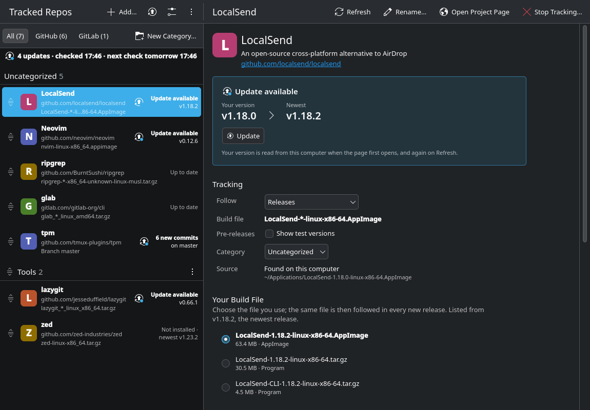

# couriercollie

Inspired by [Obtainium](https://github.com/ImranR98/Obtainium), keep the software you got from GitHub and GitLab up to date, in one simple window.



AppImages, programs from release archives, downloaded `.rpm` or `.deb` files and git clones never get updates from
your package manager. couriercollie keeps track of them, tells you when there's a new version, and updates them with
a click.

## Why another tool?

Each existing tool covers one piece:

| Tool | What it does | What it misses |
| --- | --- | --- |
| Topgrade | Runs your package managers | Software you got from GitHub |
| Gear Lever, AppImageLauncher | AppImages | Everything else |
| eget | Downloads a release's program | Runs in a terminal, one at a time |
| nvchecker | Tells you about new versions | Doesn't update anything |
| Discover | Packages and Flatpaks | What you downloaded yourself |

couriercollie does all of it in one app.

## Install

Download the package for your distro from [Releases](https://github.com/FalloutSeeker/couriercollie/releases), then:

| Distro | Command |
| --- | --- |
| Fedora 43+ | `sudo dnf install ./couriercollie-*.fc*.noarch.rpm` |
| openSUSE Tumbleweed, Leap 16+ | `sudo zypper install --allow-unsigned-rpm ./couriercollie-*.noarch.rpm` |
| Ubuntu 26.04+, Debian 13+ | `sudo apt install ./couriercollie_*_all.deb` |
| Arch (btw) | `sudo pacman -U ./couriercollie-*-any.pkg.tar.zst` |

Your package manager installs everything else it needs. Then open **couriercollie** from your app menu.

**Or run it from the source**, on any distro, once [PySide6](https://github.com/pyside/pyside-setup) and [Kirigami](https://github.com/KDE/kirigami) are installed:

```sh
git clone https://github.com/FalloutSeeker/couriercollie
cd couriercollie
./run.sh
```

<details>
<summary>Installing PySide6 and Kirigami</summary>

| Distro | Command |
| --- | --- |
| Fedora | `sudo dnf install python3-pyside6 kf6-kirigami` |
| openSUSE | `sudo zypper install python3 python3-pyside6 kf6-kirigami-imports` |
| Ubuntu, Debian | `sudo apt install python3-pyside6.qtquick python3-pyside6.qtwidgets python3-pyside6.qtdbus python3-pyside6.qtnetwork qml6-module-org-kde-kirigami qml6-module-qtquick-controls qml6-module-qtquick-dialogs qml6-module-qtquick-layouts` |
| Arch (btw) | `sudo pacman -S pyside6 kirigami` |

Kirigami is KDE's toolkit for app windows: one library, not the rest of KDE.

</details>

## Use it

1. **Add** a project by pasting its GitHub or GitLab address. Or turn on scanning in Settings, then click **Scan**
   to find what's already on your computer.
2. **Open it** and pick your file (the AppImage, archive or package you use), or a branch to follow.
3. **Update** when the list says there's a new version.

Settings has how often to check (or never), notifications, start at login, the tray, scan folders and GitHub
sign-in.

## Good to know

**Is it safe?**

- Nothing updates until you click Update.
- Downloads are checked against the project's published checksum. You're warned when there isn't one.
- couriercollie never asks for or sees your password. Installing a package, or updating a git clone owned by the
  system (one in `/opt`, say), uses your desktop's own password window.
- For a git clone, you can approve one step to run after each update (rebuild its containers, run its install
  script, etc.). It's shown to you first, and if an update changes it, it waits for you to look again.
- A step that needs elevation is never run inside couriercollie. You get its command to run in your own terminal,
  where you type the password.
- Anything your package manager installed (from your distro's repositories, or from Flathub) is never updated here.
  couriercollie only shows its version; your package manager keeps it up to date.

**Does it run all the time?** No, but automatic checks don't need the window. With them on, a small background
timer runs a quick check now and then, and exits, even after you close the window. Turn automatic checks off in
Settings and nothing runs unless you open couriercollie.

**Do I need to sign in to GitHub?** Only if you track a lot of GitHub projects. GitHub allows 60 requests an hour
without signing in, and 5,000 with.

- couriercollie uses its registered app identity to ask GitHub for a read-only, public-data token on behalf of
  whoever signs in.
- That login can't see anything private or change anything.
- It's kept in your desktop's password store (KDE Wallet, GNOME Keyring, etc.).
- You can revoke it anytime in GitHub's Settings → Applications.

**What does a scan find?** Only what your package manager can't update:

- Git clones and AppImages in your scan folders.
- Packages installed from a downloaded file that no repository you have offers.
- Flatpak bundles installed from a file.

The scan folders are your home folder, `/opt`, `/usr/local` and `/srv`, where software installed by hand lives. The
rest of the system belongs to your package manager. Change them in Settings.

**Which distros?** It's built and tested mainly on Fedora KDE. openSUSE, Ubuntu, Debian, Arch and GNOME are
supported, but need feedback (Settings → Send Feedback…).

**Start over:** `./run.sh --reset` brings the welcome screen back. Your old settings are kept as a dated backup in
`~/.config/couriercollie`.

**Uninstall:** remove the package (e.g. `sudo dnf remove couriercollie`), or delete the folder if you ran it from
source. Background checks turn themselves off the next time they'd run. Your settings, results and cache stay
behind; delete `~/.config/couriercollie`, `~/.local/state/couriercollie` and `~/.cache/couriercollie` to remove
everything.

<details>
<summary>Where it keeps things</summary>

| What | Where |
| --- | --- |
| Settings and your list | `~/.config/couriercollie/repos.toml` |
| Backups from `--reset` | `~/.config/couriercollie/repos.toml.backup-<date>` |
| Last check's results | `~/.local/state/couriercollie/checks.json` |
| Icons, release lists | `~/.cache/couriercollie/` |
| Background checks (only while on) | `~/.config/systemd/user/couriercollie-check.timer` |
| AppImages it installs | `~/Applications` |
| Programs it installs | `~/.local/share/couriercollie/programs`, linked from `~/.local/bin` |
| Projects it clones | `~/src` |
| GitHub sign-in (only if you sign in) | Your desktop's password store |

</details>

## Coming Soon

- **`collie` command:** check for updates and update from the terminal.

## License

couriercollie is free software under the [GNU General Public License](LICENSE), version 3 or later. The Breeze
icons it brings along are KDE's, under the LGPL 3.0 or later.
