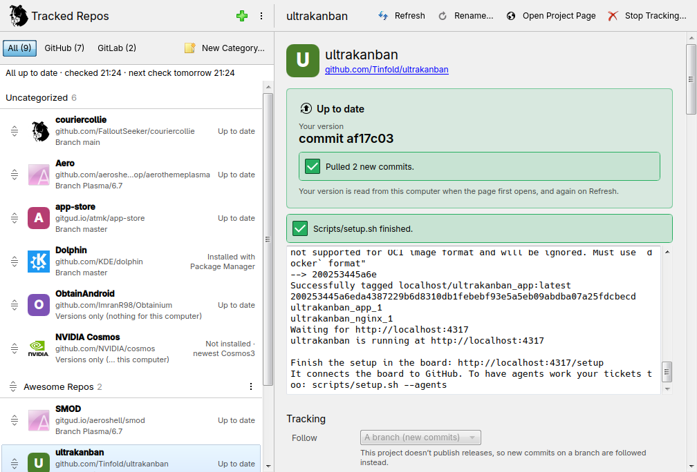

# couriercollie

<p align="center">
  
</p>

⚠️ **Beta:** couriercollie still needs testing and feedback from more users. Please report problems with Send Feedback (in Settings) or as a [GitHub issue](https://github.com/FalloutSeeker/couriercollie/issues).

Inspired by [Obtainium](https://github.com/ImranR98/Obtainium), keep the software you got from GitHub and GitLab up to date, in one simple window.




AppImages, programs from release archives, downloaded `.rpm` or `.deb` files and git clones never get updates from
your package manager. couriercollie keeps track of them, tells you when there's a new version, and updates them with
a click.

## Install

Download the package for your distro from [Releases](https://github.com/FalloutSeeker/couriercollie/releases), then:

| Distro | Command |
| --- | --- |
| Fedora 43+ | `sudo dnf install ./couriercollie-*.fc*.noarch.rpm` |
| openSUSE Tumbleweed, Leap 16+ | `sudo zypper install --allow-unsigned-rpm ./couriercollie-*.noarch.rpm` |
| Ubuntu 26.04+, Debian 13+ | `sudo apt install ./couriercollie_*_all.deb` |
| Arch (btw) | `sudo pacman -U ./couriercollie-*-any.pkg.tar.zst` |

Your package manager installs everything else it needs. Then open **couriercollie** from your app menu.

**Or run it from the source**, on any distro, once [PySide6](https://github.com/pyside/pyside-setup) and [Kirigami](https://github.com/KDE/kirigami) are installed:

```sh
git clone https://github.com/FalloutSeeker/couriercollie
cd couriercollie
./run.sh
```

<details>
<summary>Installing PySide6 and Kirigami</summary>

| Distro | Command |
| --- | --- |
| Fedora | `sudo dnf install python3-pyside6 kf6-kirigami` |
| openSUSE | `sudo zypper install python3 python3-pyside6 kf6-kirigami-imports` |
| Ubuntu, Debian | `sudo apt install python3-pyside6.qtquick python3-pyside6.qtwidgets python3-pyside6.qtdbus python3-pyside6.qtnetwork qml6-module-org-kde-kirigami qml6-module-qtquick-controls qml6-module-qtquick-dialogs qml6-module-qtquick-layouts` |
| Arch (btw) | `sudo pacman -S pyside6 kirigami` |

Kirigami is KDE's toolkit for app windows: one library, not the rest of KDE.

</details>

## Use it

1. **Add** a project by pasting its GitHub or GitLab address. Or turn on scanning in Settings, then click **Scan**
   to find what's already on your computer.
2. **Open it** and pick your file (the AppImage, archive or package you use), or a branch to follow.
3. **Update** when the list says there's a new version.

Settings has how often to check (or never), notifications, start at login, the tray, scan folders and GitHub
sign-in.

## Good to know

**Is it safe?**

- Nothing updates until you click Update.
- Downloads are checked against the project's published checksum. You're warned when there isn't one.
- couriercollie never sees your password: your desktop's own password window asks for it. If an install script
  needs `sudo` and your desktop has no password helper for it, you get the command to run in a terminal instead.
- Git clones: the first Update shows you the install script it will run after downloading, and if an update changes
  it, waits for you to look again.
- Anything your package manager installed (from your distro's repositories, or from Flathub) is never updated here.
  couriercollie only shows its version; your package manager keeps it up to date.

**Does it run all the time?** No. With automatic checks on, a small background timer checks now and then and exits,
even with the window closed. Turn them off and nothing runs unless you open couriercollie.

**Do I need to sign in to GitHub?** Only if you track a lot of GitHub projects. GitHub allows 60 requests an hour
without signing in, and 5,000 with.

- The login is read-only: it can't see anything private or change anything.
- It's kept in your desktop's password store (KDE Wallet, GNOME Keyring, etc.).
- Revoke it anytime in GitHub's Settings → Applications.

**What does a scan find?** Only what your package manager can't update:

- Git clones and AppImages in your scan folders.
- Packages installed from a downloaded file that no repository you have offers.
- Flatpak bundles installed from a file.

Scan folders are your home folder, `/opt`, `/usr/local` and `/srv` by default; change them in Settings.

**Which distros?** It's built and tested mainly on Fedora KDE. openSUSE, Ubuntu, Debian, Arch and GNOME are
supported, but need feedback (Settings → Send Feedback…).

**Start over:** `./run.sh --reset` brings the welcome screen back. Your old settings are kept as a dated backup.

**Uninstall:** remove the package (e.g. `sudo dnf remove couriercollie`), or delete the folder if you ran it from
source. Background checks stop on their own. To remove everything, also delete `~/.config/couriercollie`,
`~/.local/state/couriercollie` and `~/.cache/couriercollie`.

<details>
<summary>Where it keeps things</summary>

| What | Where |
| --- | --- |
| Settings and your list | `~/.config/couriercollie/repos.toml` |
| Backups from `--reset` | `~/.config/couriercollie/repos.toml.backup-<date>` |
| Last check's results | `~/.local/state/couriercollie/checks.json` |
| Icons, release lists | `~/.cache/couriercollie/` |
| Background checks (only while on) | `~/.config/systemd/user/couriercollie-check.timer` |
| AppImages it installs | `~/Applications` |
| Programs it installs | `~/.local/share/couriercollie/programs`, linked from `~/.local/bin` |
| Projects it clones | `~/src` |
| GitHub sign-in (only if you sign in) | Your desktop's password store |

</details>

## Coming Soon

- **`collie` command:** check for updates and update from the terminal.
- Ability to track private repositories.

## License

couriercollie is free software under the [GNU General Public License](LICENSE), version 3 or later. The Breeze
icons it brings along are KDE's, under the LGPL 3.0 or later.
